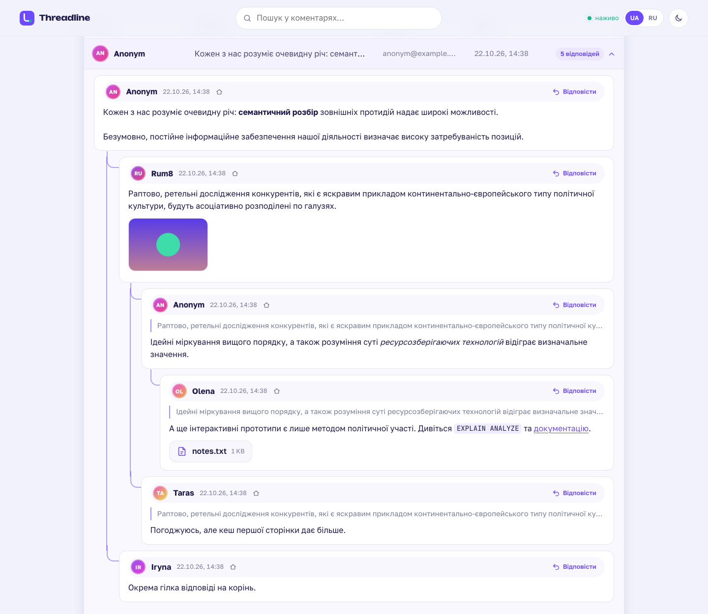
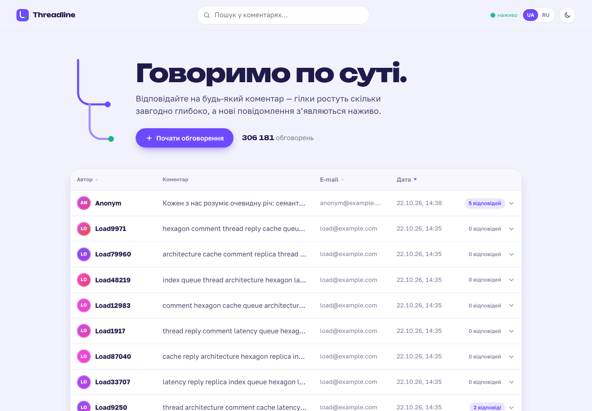
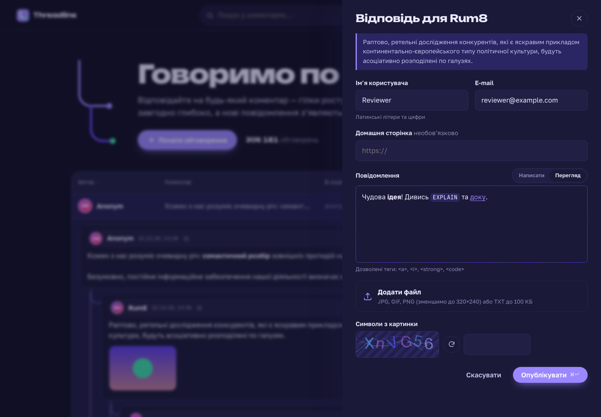
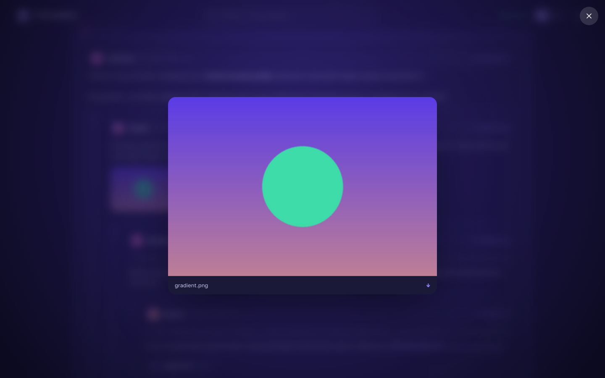
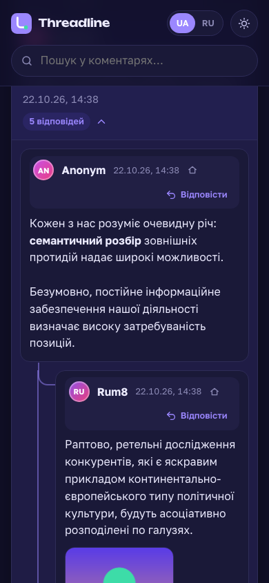

# Threadline — SPA-комментарии с древовидными ответами

[Українська](README.md) · **Русский**

Одностраничное приложение, где пользователи оставляют комментарии и отвечают на них на любой глубине. Новые сообщения появляются во всех открытых вкладках вживую, без перезагрузки.

Бэкенд: Django в **гексагональной архитектуре** (ports & adapters). Фронтенд: Vue 3. Всё окружение поднимается одной командой `docker compose up`.



| Главная | Форма (тёмная тема) |
|---|---|
|  |  |
| **Lightbox** | **Мобильная версия** |
|  |  |

---

## Содержание

- [Возможности](#возможности)
- [Как выполнены требования ТЗ](#как-выполнены-требования-тз)
- [Стек](#стек)
- [Быстрый старт (локально)](#быстрый-старт-локально)
- [Развёртывание на сервере](#развёртывание-на-сервере)
- [Структура проекта](#структура-проекта)
- [Тесты и качество кода](#тесты-и-качество-кода)
- [Документация](#документация)

## Возможности

- **Каскадные ответы любой глубины.** Каждая ветка соединена «нитями», а ответ на ответ показывает цитату родительского комментария.
- **Таблица заглавных комментариев.** Сортировка по User Name, E-mail и дате в обе стороны, по умолчанию LIFO. По 25 записей на страницу.
- **Форма.** Поля User Name (латиница и цифры), E-mail, Home page (необязательное), CAPTCHA-картинка и текст. Валидация выполняется и на клиенте, и на сервере.
- **Разрешённые теги** `<a href title>`, `<i>`, `<strong>`, `<code>`. Есть панель кнопок `[i] [strong] [code] [a]`, проверка закрытия тегов и валидного XHTML.
- **Предпросмотр.** Сообщение рендерит сервер ровно так, как оно будет сохранено, без перезагрузки страницы.
- **Файлы.** Картинки JPG/GIF/PNG пропорционально уменьшаются до 320×240 (анимация GIF сохраняется). TXT принимается до 100 КБ. Просмотр открывается в lightbox, который зумирует изображение прямо из миниатюры.
- **Live-обновления через WebSocket.** Новый корень «въезжает» в таблицу, новый ответ «прорастает» по нити. Если вы на другой странице или с другой сортировкой, появляется плашка «N новых комментариев».
- **Полнотекстовый поиск** на Elasticsearch.
- **Интерфейс UA/RU**, светлая и тёмная тема, адаптивная вёрстка до 360 px, доступность с клавиатуры, поддержка `prefers-reduced-motion`.
- **API:** REST с OpenAPI/Swagger (`/api/docs`), GraphQL (`/graphql`), WebSocket (`/ws/comments/`).

## Как выполнены требования ТЗ

| Требование | Реализация |
|---|---|
| ООП, SQL | Доменные сущности и value objects, use case-классы, порты-протоколы. PostgreSQL 17 |
| Данные о пользователе | `username`, `email`, `home_page`, а также `client_id` (анонимный JWT), `ip`, `user_agent` |
| Каскадное отображение | Materialized path + `root_id`: вся ветка читается одним индексным запросом |
| Таблица, сортировка, LIFO, 25 на страницу | Частичные индексы под каждое поле сортировки, deferred join для глубоких страниц |
| XSS | Allow-list парсер (стек тегов, проверка `href`), повторная сериализация, `nh3` на сервере, DOMPurify в браузере, CSP |
| SQL-инъекции | Только ORM и параметризованные запросы, сортировка из allow-list |
| CAPTCHA | Своя генерация (Pillow), одноразовая, в Redis с TTL, атомарный `GETDEL` |
| Файлы | Тип определяется по magic bytes, защита от decompression bomb, EXIF удаляется |
| Валидация на клиенте и сервере | TypeScript-зеркало правил; сервер остаётся источником истины и возвращает ошибки по полям |
| Django, Django ORM, Vue, Docker, Git, WebSocket | Да. История Git с feature-ветками и merge-коммитами |
| **Junior+:** Queue, Cache, Events, JWT | Celery-очередь; Redis-кэш с версионной инвалидацией; доменное событие `CommentPosted`; анонимные JWT-сессии |
| **Middle:** GraphQL, брокер, NoSQL, Cloud | Strawberry GraphQL; RabbitMQ; Elasticsearch + Redis; готов к любому VDS/облаку (Docker + Caddy HTTPS) |
| **Middle+:** 1 000 000 сообщений, 100 тыс. пользователей в сутки | Архитектура в [docs/ru/scaling.md](docs/ru/scaling.md); Locust-тест с проверкой SLO в `loadtest/` |
| Схема БД для MySQL Workbench | [docs/db/schema.mysql.sql](docs/db/schema.mysql.sql) |

## Стек

**Backend:** Python 3.12 · Django 5.2 · DRF + drf-spectacular · Strawberry GraphQL · Channels · Celery · PostgreSQL 17 · Redis 7 · RabbitMQ 4 · Elasticsearch 8 · Pillow · nh3 · PyJWT · gunicorn (HTTP) + uvicorn (WebSocket)
**Frontend:** Vue 3.5 · TypeScript · Vite 6 · DOMPurify
**Infra:** Docker multi-stage · docker compose · nginx (edge proxy, CSP, rate limit) · Caddy (HTTPS) · Locust

## Быстрый старт (локально)

Нужен только Docker (Docker Desktop или Docker Engine с плагином compose).

```bash
git clone <repo-url> threadline && cd threadline
cp .env.example .env                 # для локального запуска достаточно заменить пароли
docker compose up -d --build         # первый запуск 3–5 мин
```

| Что | Адрес |
|---|---|
| Приложение | http://localhost:8080 |
| Swagger / OpenAPI | http://localhost:8080/api/docs |
| GraphQL (GraphiQL) | http://localhost:8080/graphql |
| Django admin | http://localhost:8080/admin/ (`docker compose exec backend python manage.py createsuperuser`) |
| RabbitMQ UI | http://localhost:15672 (логин и пароль из `.env`) |

Демо-данные:

```bash
docker compose exec backend python manage.py seed_comments --count 5000
docker compose exec backend python manage.py search_reindex
```

## Развёртывание на сервере

Пошаговая инструкция (VDS с Ubuntu, домен, HTTPS, обновления, бэкапы): **[docs/ru/deployment.md](docs/ru/deployment.md)**.

Кратко:

```bash
cp .env.example .env    # заполнить секреты, DOMAIN, DJANGO_ALLOWED_HOSTS
docker compose -f docker-compose.yml -f docker-compose.prod.yml up -d --build
```

## Структура проекта

```
backend/
  src/comments/
    domain/          # чистый Python: Comment, UserName/Email/HomePage, CommentText (XHTML), Upload
    application/     # use cases + порты (typing.Protocol)
    adapters/
      inbound/       # REST, GraphQL, WebSocket, Celery tasks, management-команды
      outbound/      # ORM-репозиторий, кэш, капча, Pillow, nh3, Elasticsearch, RabbitMQ, Channels
    bootstrap.py     # composition root: какой адаптер стоит за каким портом
  src/config/        # Django settings (12-factor), ASGI, Celery
  tests/             # unit (без БД) + integration (API, WebSocket)
frontend/            # Vue 3 SPA + nginx.conf
loadtest/            # Locust-сценарий и скрипт прогона
deploy/              # Caddyfile для HTTPS
docs/                # документация UA/RU, схема БД
docker-compose.yml           # полный стек
docker-compose.prod.yml      # продакшн-оверлей (HTTPS)
docker-compose.loadtest.yml  # оверлей для нагрузочного теста
```

## Тесты и качество кода

```bash
# В Docker, на настоящих PostgreSQL + Redis:
docker compose --profile test run --rm tests

# Или локально (SQLite + in-memory адаптеры, без каких-либо сервисов):
cd backend && pip install -e '.[dev]' && pytest

ruff check src tests && mypy src && lint-imports          # стиль, типы (strict), границы гексагона
cd frontend && npm run typecheck
```

- **77 тестов.** Юнит-тесты домена и use cases с in-memory фейками, без Django и БД. Интеграционные тесты REST, GraphQL и WebSocket.
- **`import-linter` проверяет границы гексагона.** Домен и приложение не могут импортировать Django, Redis, Celery и т. п. Слои не могут импортировать «вверх».
- **mypy в strict-режиме.**

## Документация

| Документ | По-русски | Українською |
|---|---|---|
| Архитектура и решения (ADR) | [docs/ru/architecture.md](docs/ru/architecture.md) | [docs/uk/architecture.md](docs/uk/architecture.md) |
| Развёртывание шаг за шагом | [docs/ru/deployment.md](docs/ru/deployment.md) | [docs/uk/deployment.md](docs/uk/deployment.md) |
| Масштабирование и нагрузочный тест | [docs/ru/scaling.md](docs/ru/scaling.md) | [docs/uk/scaling.md](docs/uk/scaling.md) |
| API: REST, GraphQL, WebSocket | [docs/ru/api.md](docs/ru/api.md) | [docs/uk/api.md](docs/uk/api.md) |
| Сценарий демо-видео | [docs/ru/video.md](docs/ru/video.md) | [docs/uk/video.md](docs/uk/video.md) |
| Схема БД | [docs/db/schema.mysql.sql](docs/db/schema.mysql.sql) (Workbench) · [docs/db/schema.postgresql.sql](docs/db/schema.postgresql.sql) (фактическая) | |
