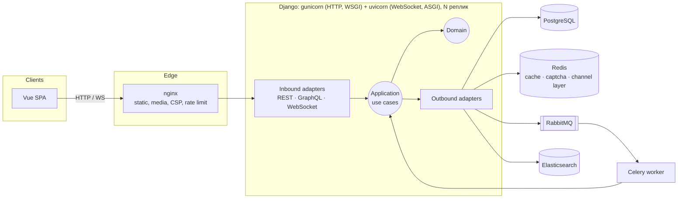
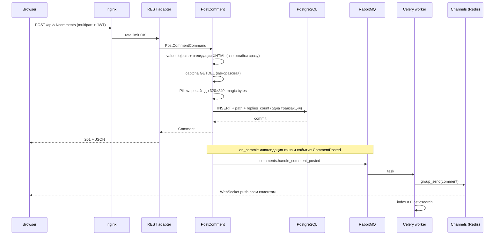
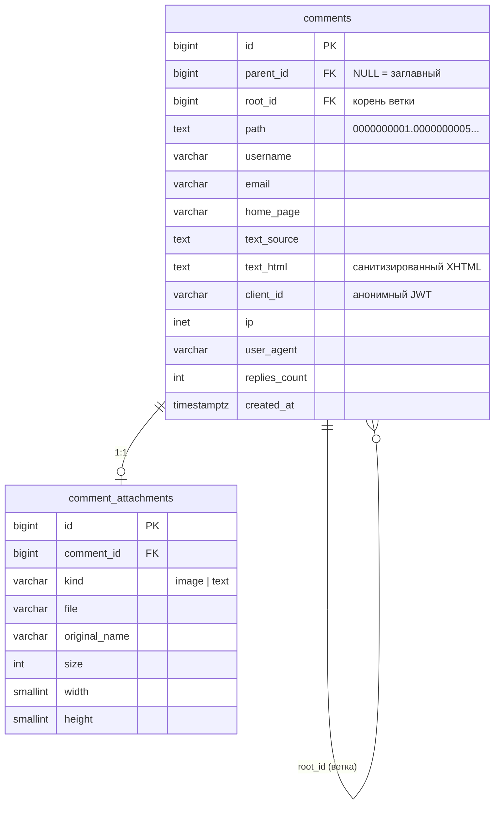

# Архитектура

[← README](../../README.ru.md) · [Українська](../uk/architecture.md)

## Общая картина



## Гексагональная архитектура (ports & adapters)

```
backend/src/comments/
├── domain/        Чистая бизнес-модель. Ни одного импорта Django, Redis и т. п.
│   ├── values.py      UserName, Email, HomePage, Ordering. Валидируются в конструкторе
│   ├── markup.py      CommentText: allow-list парсер XHTML
│   ├── attachment.py  Upload: тип по magic bytes, лимиты размера
│   ├── comment.py     Comment, materialized path
│   └── events.py      CommentPosted
├── application/   Сценарии и порты, от которых они зависят
│   ├── ports.py       CommentRepository, CaptchaStore, ImageProcessor, SearchIndex,
│   │                  EventPublisher, Broadcaster, FileStorage, HtmlSanitizer, TransactionManager
│   ├── use_cases.py   PostComment, PreviewComment, ListRootComments, GetThread,
│   │                  SearchComments, IssueCaptcha, HandleCommentPosted
│   └── dto.py         команды, запросы, Page, ThreadSlice
├── adapters/
│   ├── inbound/       То, что «управляет» приложением: REST, GraphQL, WebSocket, Celery, CLI
│   └── outbound/      То, чем приложение управляет: ORM, Redis, Pillow, nh3, ES, RabbitMQ, Channels
└── bootstrap.py   Composition root: собирает адаптеры в use cases
```

**Правило зависимостей:** `inbound → bootstrap → outbound → application → domain`. Импортировать «вверх» нельзя.

Это проверяется автоматически, а не только договорённостью: `lint-imports` (конфиг в `backend/.importlinter`) падает, если домен или приложение импортирует `django`, `redis`, `celery`, `PIL` и т. п., либо если слой нарушает порядок.

### Почему именно так

1. **ORM-модели — деталь адаптера.** `CommentRecord` живёт в `adapters/outbound/persistence`, а репозиторий превращает его в доменный `Comment`. Иначе `models.Model` протекает в бизнес-логику, и «гексагон» остаётся только названием папок.
2. **Порты — это `typing.Protocol`.** Адаптеры удовлетворяют их структурно, без наследования от ядра. Меньше церемоний, а mypy (strict) проверяет совместимость.
3. **Один use case обслуживает все транспорты.** `ListRootComments` вызывают REST, GraphQL и тесты. `HandleCommentPosted` вызывает Celery-воркер. Логика не дублируется.
4. **Тестируемость.** Юнит-тесты ядра подставляют in-memory фейки (`tests/fakes.py`) и проходят за миллисекунды без БД.
5. **Замена технологии — одна правка в `bootstrap.py`.** Без Elasticsearch подставляется `DatabaseSearchIndex`. Без Redis — `CacheCaptchaStore`. Без брокера события обрабатываются inline. Кэш реализован как декоратор `CachedCommentRepository` поверх любого репозитория, поэтому use cases о нём не знают.
6. **Прагматизм.** Админку, миграции и settings в порты не оборачиваем. Это «Django-way», и так правильно: гексагон нужен там, где живёт бизнес-логика.

## Поток «опубликовать комментарий»



Событие публикуется **после commit** (`transaction.on_commit`). Воркер никогда не получит id строки, которой ещё не видно, а при откате транзакции событие просто не уйдёт.

## Модель данных



Файлы схемы: [schema.mysql.sql](../db/schema.mysql.sql) для MySQL Workbench и [schema.postgresql.sql](../db/schema.postgresql.sql), фактический DDL миграции.

## Архитектурные решения (ADR)

### ADR-1. PostgreSQL вместо MySQL

Нужны частичные индексы (`WHERE parent_id IS NULL`), функциональные индексы (`LOWER(username)`) и тип `inet`. В PostgreSQL всё это есть из коробки. Частичные индексы по корням в 3–4 раза меньше полных и помещаются в RAM. Для Workbench отдельно подготовлен MySQL-диалект схемы.

### ADR-2. Дерево как materialized path + root_id

| Вариант | Чтение ветки | Вставка | Почему нет / да |
|---|---|---|---|
| Adjacency list + рекурсивный CTE | N уровней рекурсии | O(1) | Медленно на глубоких ветках, сложно пагинировать |
| Nested sets | 1 запрос | Пересчёт половины дерева | Неприемлемо при активной записи |
| Closure table | 1 запрос | O(глубина) строк | Отдельная таблица растёт как N×глубина |
| **Materialized path + root_id** | **1 range scan** | **O(1)** | ✅ |

`path` состоит из id фиксированной ширины, например `0000000001.0000000042`. Лексикографический порядок совпадает с обходом дерева в глубину с хронологией внутри ветки. Поэтому `WHERE root_id = ? ORDER BY path` отдаёт всю ветку одним проходом по индексу `(root_id, path)`, а `path > cursor` даёт keyset-пагинацию для очень больших веток.

### ADR-3. Денормализация автора и частичные индексы под каждую сортировку

Таблица корней — самый горячий запрос. `username` и `email` лежат прямо в строке комментария, без JOIN. Под каждое поле сортировки есть частичный индекс с `id` как tiebreaker: `ORDER BY … LIMIT 25` — это index scan без сортировки в памяти.

Для глубоких страниц применён **deferred join**: сначала из узкого индекса берутся только 25 id, затем подгружаются полные строки. Большой `OFFSET` пропускает записи индекса, а не строки таблицы.

### ADR-4. Безопасность разметки: парсим и сериализуем заново, а не фильтруем

`CommentText.parse` токенизирует ввод регулярным выражением, проверяет allow-list тегов и атрибутов (`href` разрешён только с `http`, `https` или `mailto`) и стеком проверяет закрытие тегов. Затем **строит HTML заново** из токенов: текст экранируется, атрибуты берутся в кавычки. Поэтому ничего из введённого буквально на страницу не попадает.

Дальше идут ещё три независимых слоя: `nh3` (ammonia, Rust) на сервере, DOMPurify в браузере и CSP `script-src 'self'` в nginx.

### ADR-5. События, очередь, кэш

- **`CommentPosted` → RabbitMQ → Celery.** Push в WebSocket и индексация в Elasticsearch выполняются асинхронно, поэтому запись быстрая. Задача с `acks_late` и retry с backoff.
- **Кэш с версионной инвалидацией.** Ключи вида `roots:v{N}:…`. Новый комментарий делает `INCR roots:ver`, и старые страницы становятся недостижимы за O(1), а потом сами истекают по TTL. Кэшируются только первые 10 страниц: глубокие редко повторяются.
- **Redis падает — чтение работает.** Для кэша включён `IGNORE_EXCEPTIONS`.

### ADR-6. Анонимная идентификация через JWT

Регистрации в ТЗ нет, но нужны данные, «идентифицирующие клиента». SPA получает подписанный токен со случайным `client_id`. Он передаётся с каждой записью и в WebSocket-handshake. Это даёт per-client rate limit и атрибуцию без учётных записей. Алгоритм зафиксирован (`HS256`), `alg` из токена не доверяется.

### ADR-7. Транспорты: REST для записи, GraphQL для чтения, WebSocket для push

Загрузка файлов естественно ложится на multipart REST. GraphQL покрывает чтение (`comments`, `thread`, `search`) и `previewComment`, где выборка полей действительно полезна. WebSocket только пушит. Все три адаптера вызывают одни и те же use cases.

### ADR-8. CAPTCHA своя

Она работает без внешних сервисов и без интернета. Ответ лежит в Redis с TTL 5 мин и забирается атомарно `GETDEL`: два параллельных запроса не пройдут с одной капчей. Неверная попытка тоже «сжигает» капчу.

### ADR-9. HTTP через WSGI (gunicorn), WebSocket через ASGI (uvicorn)

Первая версия отдавала всё через ASGI. Нагрузочный тест показал, что синхронные Django/DRF-view под ASGI платят за переход async→thread на каждый запрос и на каждый sync-middleware: `backend` занимал 3 ядра при 170 req/s, а p95 доходил до 350–470 мс. После разделения (gunicorn `gthread` для HTTP, uvicorn только для `/ws/`) при той же нагрузке имеем p95 15 мс и 0,7 ядра. Образ тот же, роли разные, nginx маршрутизирует по пути. Подробности в [scaling.md](scaling.md#4-результаты).

## Безопасность — кратко

- **XSS:** 4 слоя (ADR-4). CSP на SPA. Медиа отдаются с `nosniff`, `sandbox` и жёстким `Content-Type`.
- **SQL-инъекции:** только ORM, сортировка из allow-list (`Ordering.parse`, `ChoiceField`).
- **Загрузки:** тип по magic bytes, лимит пикселей (decompression bomb), перекодирование изображения (EXIF и «полиглоты» удаляются), случайные имена файлов.
- **Злоупотребления:** nginx `limit_req` per-IP и DRF-throttles per-client (JWT).
- **Секреты:** только из `.env`. Без `DJANGO_SECRET_KEY` в продакшне приложение не стартует.
- **Контейнеры:** non-root, multi-stage, минимальный runtime.
