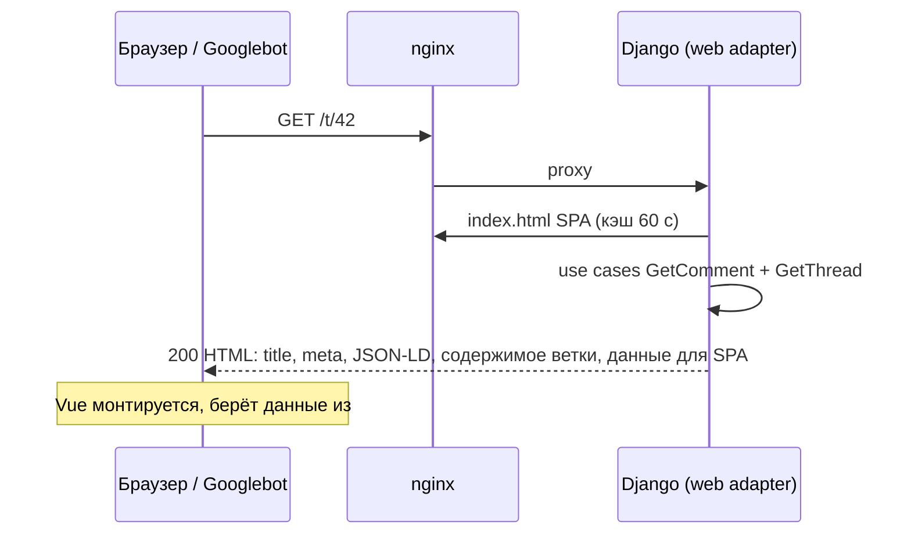

# SEO и индексация

[← README](../../README.ru.md) · [Українська](../uk/seo.md)

## Подход: server-side rendering для краулеров и первого открытия

Googlebot умеет выполнять JavaScript, но делает это с задержкой (отдельная очередь рендеринга) и не всегда полностью. Другие поисковики и соцсети (превью в Telegram, Facebook, X) JavaScript не выполняют вовсе. Поэтому страницы, которые должны попадать в индекс, сервер отдаёт **готовым HTML**:



- **Те же use cases, что и REST/GraphQL.** Server rendering — ещё один входящий адаптер (`adapters/inbound/web`), бизнес-логика не дублируется.
- **Оболочка — настоящий собранный `index.html` SPA** с хэшированными ассетами. Сервер вставляет `<head>`-метаданные между маркерами `<!--seo:head-->` и контент между `<!--seo:body-->`.
- **Без мигания и двойных запросов.** Данные страницы встроены в `<script id="tl-initial" type="application/json">`, и SPA стартует с них.
- **Деградация.** Если Django недоступен, nginx отдаёт статический SPA, и сайт не становится пустым.

## Что реализовано

| Что | Где |
|---|---|
| Отдельный URL для каждой ветки `/t/<id>`; permalink на ответ `/t/<root>#c<id>` (301 с `/t/<reply>`) | `web/views.py`, кнопка `#` у каждого комментария |
| `<title>`, `meta description`, `canonical` | каждая страница |
| `hreflang` uk / ru / x-default (`?lang=ru`) | head + sitemap (`xhtml:link`) |
| `rel=prev/next` на пагинации главной | head + ссылки в теле |
| Open Graph и Twitter Card, OG-картинка 1200×630 (для ветки с фото — само фото) | head, `public/og-image.png` |
| JSON-LD `WebSite` + `SearchAction` (поле поиска в Google) | главная; `/?q=…` открывает поиск в SPA |
| JSON-LD `DiscussionForumPosting` с автором, датой, счётчиком ответов и первыми 100 ответами | страница ветки |
| `robots.txt` с запретом `/api/`, `/graphql`, `/admin/`, сортировок и поиска | `/robots.txt` |
| `sitemap.xml` как индекс: страницы главной + файлы по 5000 веток, старые первыми (файлы стабильны), кэш 1 ч | `/sitemap.xml`, `/sitemaps/*.xml` |
| Настоящий `404` с `noindex` для несуществующих веток; `302` для страницы за пределами | статусы HTTP |
| `noindex,follow` для сортировок и поиска (дубликаты канонических страниц) | meta robots |
| `X-Robots-Tag: noindex` для API и GraphQL | nginx |
| Web App Manifest, иконки 192/512/maskable, apple-touch-icon, `theme-color` для светлой и тёмной темы | `public/` |
| Защита JSON-LD от XSS: `<`, `>`, `&` в тексте комментария экранируются как `<` и т. д. | `seo.json_ld`, тест |
| `Content-Language`, `Cache-Control: public, max-age=60` для HTML | ответ |

Тесты: `backend/tests/integration/test_seo.py` (метаданные, JSON-LD, статусы, редиректы, robots, sitemap, защита от XSS).

## Lighthouse

| Страница | Профиль | Performance | Accessibility | Best Practices | SEO |
|---|---|---|---|---|---|
| Главная | Desktop | **100** | **100** | **100** | **100** |
| Ветка `/t/<id>` | Desktop | **100** | **100** | **100** | **100** |
| Главная | Mobile (замедленный 4G) | 95 | **100** | **100** | **100** |
| Ветка `/t/<id>` | Mobile (замедленный 4G) | 94 | **100** | **100** | **100** |

CLS = 0 на всех страницах, Total Blocking Time ≤ 50 мс. Отчёты: [`docs/lighthouse/`](../lighthouse/).

Что дало эти баллы:
- **Шрифты self-hosted (`@fontsource`).** Без стороннего домена и без блокирующего CSS. Критичные начертания (кириллица и латиница) имеют `preload`, поэтому заголовок не перепрыгивает после загрузки шрифта.
- **LCP-заголовок без fade-in.** Он анимируется только размытием. Невидимый элемент не считается отрисованным, и fade-in отодвинул бы LCP.
- **Серверная разметка не рисуется в браузере с JS.** Она для краулеров и превью; класс `js` ставится до первого рендера. Если приложение за 4 с не стартовало, разметка показывается.
- **Счётчик «докручивается» поверх скрытого финального числа**, которое резервирует ширину.

## Как проверить

```bash
curl -s https://comments.example.com/t/42 | grep -E '<title>|canonical|ld\+json'
curl -s https://comments.example.com/robots.txt
curl -s https://comments.example.com/sitemap.xml
```

- **Rich Results Test:** https://search.google.com/test/rich-results → URL ветки → «Discussion forum» без ошибок.
- **Проверка превью для соцсетей:** https://www.opengraph.xyz или отправить ссылку в Telegram.

## После деплоя: Google Search Console

1. https://search.google.com/search-console → **Add property** → **Domain** → ваш домен.
2. Добавьте TXT-запись, которую покажет Google, в DNS домена и нажмите **Verify**.
3. **Sitemaps** → `https://<домен>/sitemap.xml` → **Submit**.
4. **URL Inspection** → адрес ветки → **Request indexing** для нескольких ключевых страниц.
5. То же по желанию в Bing Webmaster Tools (импорт из Search Console в один клик).

В `.env` на сервере должен быть `SITE_URL=https://<домен>`: из него строятся canonical, sitemap и Open Graph.
