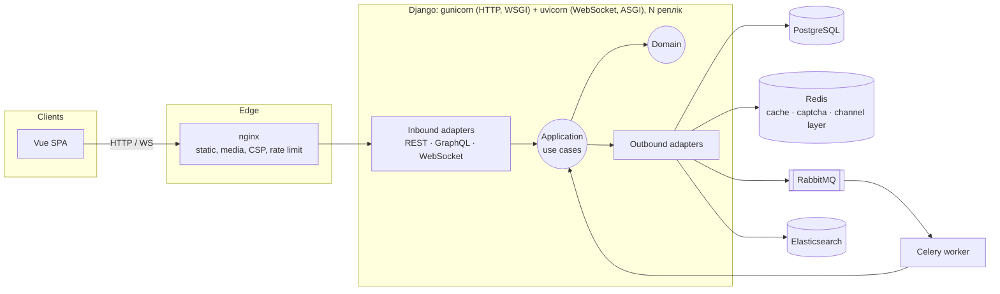
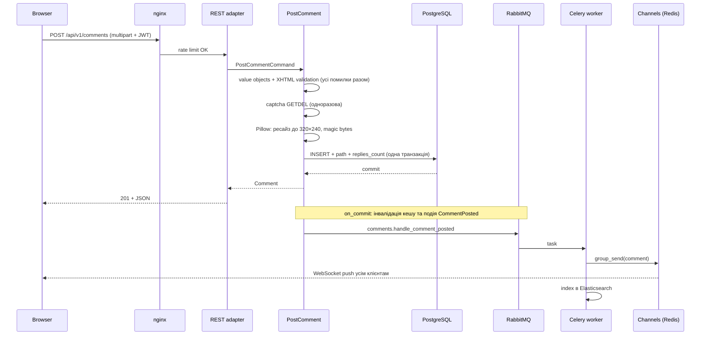
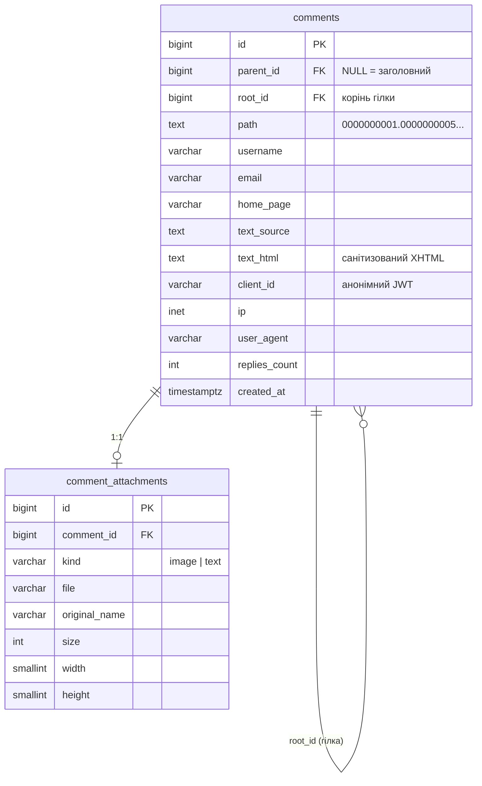

# Архітектура

[← README](../../README.md) · [Русский](../ru/architecture.md)

## Загальна картина



## Гексагональна архітектура (ports & adapters)

```
backend/src/comments/
├── domain/        Чиста бізнес-модель. Жодного імпорту Django, Redis тощо.
│   ├── values.py      UserName, Email, HomePage, Ordering. Валідуються в конструкторі
│   ├── markup.py      CommentText: allow-list парсер XHTML
│   ├── attachment.py  Upload: тип за magic bytes, ліміти розміру
│   ├── comment.py     Comment, materialized path
│   └── events.py      CommentPosted
├── application/   Сценарії й порти, від яких вони залежать
│   ├── ports.py       CommentRepository, CaptchaStore, ImageProcessor, SearchIndex,
│   │                  EventPublisher, Broadcaster, FileStorage, HtmlSanitizer, TransactionManager
│   ├── use_cases.py   PostComment, PreviewComment, ListRootComments, GetThread,
│   │                  SearchComments, IssueCaptcha, HandleCommentPosted
│   └── dto.py         команди, запити, Page, ThreadSlice
├── adapters/
│   ├── inbound/       Те, що «керує» застосунком: REST, GraphQL, WebSocket, Celery, CLI
│   └── outbound/      Те, чим застосунок керує: ORM, Redis, Pillow, nh3, ES, RabbitMQ, Channels
└── bootstrap.py   Composition root: збирає адаптери у use cases
```

**Правило залежностей:** `inbound → bootstrap → outbound → application → domain`. Імпортувати «вгору» не можна.

Це перевіряється автоматично, а не лише домовленістю: `lint-imports` (конфіг у `backend/.importlinter`) падає, якщо домен або застосунок імпортує `django`, `redis`, `celery`, `PIL` тощо, або якщо шар порушує порядок.

### Чому саме так

1. **ORM-моделі — це деталь адаптера.** `CommentRecord` живе в `adapters/outbound/persistence`, а репозиторій перетворює його на доменний `Comment`. Інакше `models.Model` протікає в бізнес-логіку, і «гексагон» лишається лише назвою папок.
2. **Порти — це `typing.Protocol`.** Адаптери задовольняють їх структурно, без наслідування від ядра. Менше церемоній, а mypy (strict) перевіряє сумісність.
3. **Один use case обслуговує всі транспорти.** `ListRootComments` викликають REST, GraphQL і тести. `HandleCommentPosted` викликає Celery-воркер. Логіка не дублюється.
4. **Тестованість.** Юніт-тести ядра підставляють in-memory фейки (`tests/fakes.py`) і проходять за мілісекунди без БД.
5. **Заміна технології — це одна правка в `bootstrap.py`.** Без Elasticsearch підставляється `DatabaseSearchIndex`. Без Redis — `CacheCaptchaStore`. Без брокера події обробляються inline. Кеш реалізований як декоратор `CachedCommentRepository` поверх будь-якого репозиторію, тож use cases про нього не знають.
6. **Прагматизм.** Адмінку, міграції та settings не обгортаємо в порти. Це «Django-way», і так правильно: гексагон потрібен там, де живе бізнес-логіка.

## Потік «опублікувати коментар»



Подія публікується **після commit** (`transaction.on_commit`). Воркер ніколи не отримає id рядка, якого ще не видно, а при відкаті транзакції подія просто не піде.

## Модель даних



Файли схеми: [schema.mysql.sql](../db/schema.mysql.sql) для MySQL Workbench і [schema.postgresql.sql](../db/schema.postgresql.sql), фактичний DDL міграції.

## Архітектурні рішення (ADR)

### ADR-1. PostgreSQL замість MySQL

Потрібні часткові індекси (`WHERE parent_id IS NULL`), функціональні індекси (`LOWER(username)`) і тип `inet`. У PostgreSQL усе це є з коробки. Часткові індекси під корені в 3–4 рази менші за повні, тому вміщаються в RAM. Для Workbench окремо підготовлено MySQL-діалект схеми.

### ADR-2. Дерево як materialized path + root_id

| Варіант | Читання гілки | Вставка | Чому ні / так |
|---|---|---|---|
| Adjacency list + рекурсивний CTE | N рівнів рекурсії | O(1) | Повільно на глибоких гілках, складно пагінувати |
| Nested sets | 1 запит | Перерахунок половини дерева | Неприйнятно для активного запису |
| Closure table | 1 запит | O(глибина) рядків | Окрема таблиця, яка росте як N×глибина |
| **Materialized path + root_id** | **1 range scan** | **O(1)** | ✅ |

`path` складається з id фіксованої ширини, наприклад `0000000001.0000000042`. Лексикографічний порядок дорівнює обходу дерева в глибину з хронологією всередині гілки. Тому `WHERE root_id = ? ORDER BY path` віддає всю гілку одним проходом по індексу `(root_id, path)`, а `path > cursor` дає keyset-пагінацію для дуже великих гілок.

### ADR-3. Денормалізація автора і часткові індекси під кожне сортування

Таблиця коренів — найгарячіший запит. `username` і `email` лежать прямо в рядку коментаря, без JOIN. Під кожне поле сортування є частковий індекс з `id` як tiebreaker: `ORDER BY … LIMIT 25` — це index scan без сортування в пам'яті.

Для глибоких сторінок застосовано **deferred join**: спочатку з вузького індексу беруться лише 25 id, потім завантажуються повні рядки. Велике `OFFSET` пропускає записи індексу, а не рядки таблиці.

### ADR-4. Безпека розмітки: парсимо й серіалізуємо заново, а не фільтруємо

`CommentText.parse` токенізує ввід регулярним виразом, перевіряє allow-list тегів і атрибутів (`href` дозволений лише з `http`, `https` чи `mailto`) і стеком перевіряє закриття тегів. Потім **будує HTML заново** з токенів: текст екранується, атрибути беруться в лапки. Тому нічого з введеного буквально на сторінку не потрапляє.

Далі йдуть ще три незалежні шари: `nh3` (ammonia, Rust) на сервері, DOMPurify у браузері і CSP `script-src 'self'` в nginx.

### ADR-5. Події, черга, кеш

- **`CommentPosted` → RabbitMQ → Celery.** Push у WebSocket та індексація в Elasticsearch виконуються асинхронно, тож запис швидкий. Задача має `acks_late` і retry з backoff.
- **Кеш з версійною інвалідацією.** Ключі мають вигляд `roots:v{N}:…`. Новий коментар робить `INCR roots:ver`, і старі сторінки стають недосяжними за O(1), а потім самі спливають за TTL. Кешуються лише перші 10 сторінок: глибокі рідко повторюються.
- **Redis падає — читання працює.** Для кешу ввімкнено `IGNORE_EXCEPTIONS`.

### ADR-6. Анонімна ідентифікація через JWT

Реєстрації в ТЗ немає, але потрібні дані, що «ідентифікують клієнта». SPA отримує підписаний токен з випадковим `client_id`. Він передається з кожним записом і в WebSocket-handshake. Це дає per-client rate limit і атрибуцію без облікових записів. Алгоритм зафіксований (`HS256`), `alg` з токена не довіряється.

### ADR-7. Транспорти: REST для запису, GraphQL для читання, WebSocket для push

Завантаження файлів природно лягає на multipart REST. GraphQL покриває читання (`comments`, `thread`, `search`) і `previewComment`, де вибірка полів справді корисна. WebSocket лише пушить. Усі три адаптери викликають ті самі use cases.

### ADR-8. CAPTCHA власна

Вона працює без зовнішніх сервісів і без інтернету. Відповідь лежить у Redis з TTL 5 хв і забирається атомарно `GETDEL`: два паралельні запити не пройдуть з однією капчею. Невірна спроба теж «спалює» капчу.

### ADR-9. HTTP через WSGI (gunicorn), WebSocket через ASGI (uvicorn)

Перша версія віддавала все через ASGI. Навантажувальний тест показав, що синхронні Django/DRF-view під ASGI платять за перехід async→thread на кожен запит і на кожен sync-middleware: `backend` займав 3 ядра при 170 req/s, а p95 сягав 350–470 мс. Після розділення (gunicorn `gthread` для HTTP, uvicorn лише для `/ws/`) при тому ж навантаженні маємо p95 15 мс і 0,7 ядра. Образ той самий, ролі різні, nginx маршрутизує за шляхом. Деталі в [scaling.md](scaling.md#4-результати).

## Стійкість до збоїв

| Що впало | Поведінка |
|---|---|
| RabbitMQ | Коментар зберігається, користувач отримує 201. Push і індексація виконуються inline (best effort), без 500 за вже збережені дані. |
| Celery-воркер | Задачі чекають у черзі (`acks_late`) і виконуються після рестарту. |
| Elasticsearch | Публікація працює. Пошук швидко (≤ 2 с) відповідає JSON 503. Індексація повторюється з backoff до ~10 хв; після довшого збою допоможе `search_reindex`. |
| Redis | Кеш вимкнено (`IGNORE_EXCEPTIONS`), читання йде з БД. Капча й live-оновлення недоступні до відновлення. |
| Push у WebSocket | Окрема задача: її збій не блокує індексацію, а повтор індексації не дублює push. |
| Деплой / рестарт | `stop_grace_period: 30s`: gunicorn, uvicorn і Celery завершують поточні запити й задачі. |

Поведінку при недоступних брокері та Elasticsearch покривають регресійні тести (`tests/*/test_qa_regressions.py`).

## Безпека — коротко

- **XSS:** 4 шари (ADR-4). CSP на SPA. Медіа віддаються з `nosniff`, `sandbox` і жорстким `Content-Type`.
- **SQL-ін'єкції:** лише ORM, сортування з allow-list (`Ordering.parse`, `ChoiceField`).
- **Завантаження:** тип за magic bytes, ліміт пікселів (decompression bomb), повторне кодування зображення (EXIF та «поліглоти» прибираються), випадкові імена файлів.
- **Зловживання:** nginx `limit_req` per-IP і DRF-throttles per-client (JWT).
- **Секрети:** лише з `.env`. Без `DJANGO_SECRET_KEY` у продакшні застосунок не стартує.
- **Контейнери:** non-root, multi-stage, мінімальний runtime.
