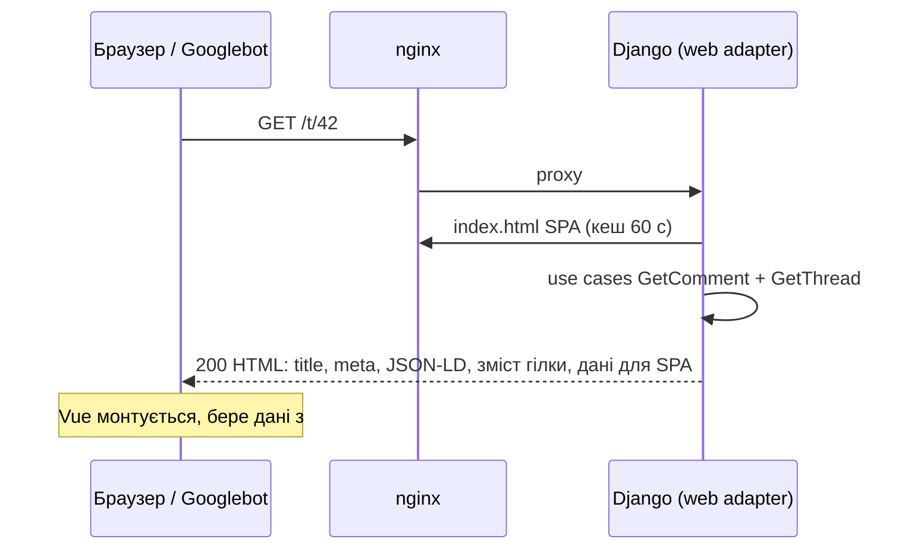

# SEO та індексація

[← README](../../README.md) · [Русский](../ru/seo.md)

## Підхід: server-side rendering для краулерів і першого відкриття

Googlebot уміє виконувати JavaScript, але робить це з затримкою (окрема черга рендерингу) і не завжди повністю. Інші пошуковики й соцмережі (превʼю в Telegram, Facebook, X) JavaScript не виконують узагалі. Тому сторінки, які мають потрапляти в індекс, сервер віддає **готовим HTML**:



- **Ті самі use cases, що й REST/GraphQL.** Server rendering — ще один вхідний адаптер (`adapters/inbound/web`), бізнес-логіка не дублюється.
- **Оболонка — справжній зібраний `index.html` SPA** з хешованими ассетами. Сервер вставляє `<head>`-метадані між маркерами `<!--seo:head-->` і контент між `<!--seo:body-->`.
- **Без миготіння й подвійних запитів.** Дані сторінки вбудовані в `<script id="tl-initial" type="application/json">`, і SPA стартує з них.
- **Деградація.** Якщо Django недоступний, nginx віддає статичний SPA, і сайт не стає порожнім.

## Що реалізовано

| Що | Де |
|---|---|
| Окрема URL для кожної гілки `/t/<id>`; permalink на відповідь `/t/<root>#c<id>` (301 з `/t/<reply>`) | `web/views.py`, кнопка `#` біля кожного коментаря |
| `<title>`, `meta description`, `canonical` | кожна сторінка |
| `hreflang` uk / ru / x-default (`?lang=ru`) | head + sitemap (`xhtml:link`) |
| `rel=prev/next` на пагінації головної | head + посилання в тілі |
| Open Graph і Twitter Card, OG-картинка 1200×630 (для гілки з фото — саме фото) | head, `public/og-image.png` |
| JSON-LD `WebSite` + `SearchAction` (поле пошуку в Google) | головна; `/?q=…` відкриває пошук у SPA |
| JSON-LD `DiscussionForumPosting` з автором, датою, лічильником відповідей і першими 100 відповідями | сторінка гілки |
| `robots.txt` із забороною `/api/`, `/graphql`, `/admin/`, сортувань і пошуку | `/robots.txt` |
| `sitemap.xml` як індекс: сторінки головної + файли по 5000 гілок, старі першими (файли стабільні), кеш 1 год | `/sitemap.xml`, `/sitemaps/*.xml` |
| Справжній `404` з `noindex` для неіснуючих гілок; `302` для сторінки за межами | статуси HTTP |
| `noindex,follow` для сортувань і пошуку (дублікати канонічних сторінок) | meta robots |
| `X-Robots-Tag: noindex` для API і GraphQL | nginx |
| Web App Manifest, іконки 192/512/maskable, apple-touch-icon, `theme-color` для світлої та темної теми | `public/` |
| Захист JSON-LD від XSS: `<`, `>`, `&` у тексті коментаря екрануються як `<` тощо | `seo.json_ld`, тест |
| `Content-Language`, `Cache-Control: public, max-age=60` для HTML | відповідь |

Тести: `backend/tests/integration/test_seo.py` (метадані, JSON-LD, статуси, редиректи, robots, sitemap, захист від XSS).

## Як перевірити

```bash
curl -s https://comments.example.com/t/42 | grep -E '<title>|canonical|ld\+json'
curl -s https://comments.example.com/robots.txt
curl -s https://comments.example.com/sitemap.xml
```

- **Rich Results Test:** https://search.google.com/test/rich-results → URL гілки → «Discussion forum» без помилок.
- **Перевірка превʼю для соцмереж:** https://www.opengraph.xyz або надіслати посилання в Telegram.

## Після деплою: Google Search Console

1. https://search.google.com/search-console → **Add property** → **Domain** → ваш домен.
2. Додайте TXT-запис, який покаже Google, у DNS домену, і натисніть **Verify**.
3. **Sitemaps** → `https://<домен>/sitemap.xml` → **Submit**.
4. **URL Inspection** → адреса гілки → **Request indexing** для кількох ключових сторінок.
5. Те саме за бажанням у Bing Webmaster Tools (імпорт із Search Console в один клік).

У `.env` на сервері має бути `SITE_URL=https://<домен>`: з нього будуються canonical, sitemap і Open Graph.
